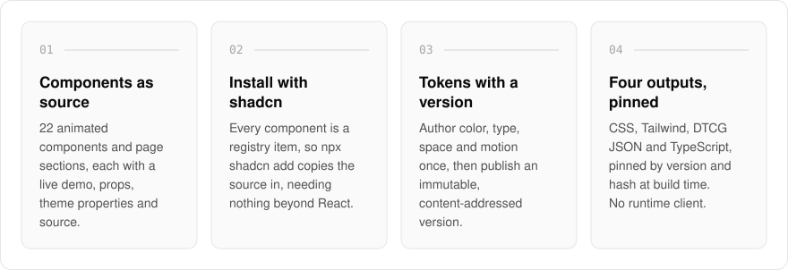
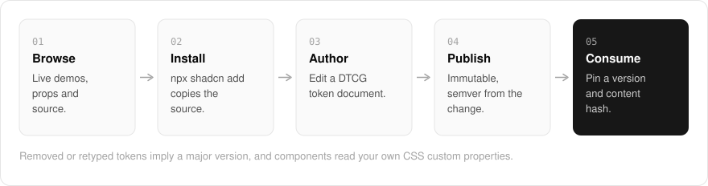

  <picture>
    <source media="(prefers-color-scheme: dark)" srcset=".github/assets/hero-dark.png">
    
  </picture>

<h1 align="center">design.me.at</h1>

<strong>Animated React components, installed as source.</strong>

  
  
  

  <a href="https://design.me.at">Website</a> ·
  <a href="#features">Features</a> ·
  <a href="#how-it-works">How it works</a> ·
  <a href="#screenshots">Screenshots</a> ·
  <a href="#built-with">Built with</a>

Component libraries arrive as a package you depend on, and design tokens drift because nothing pins them. I built design.me.at to fix both: an installable catalog of animated components and page sections you add to your project as source with the shadcn CLI, and a token studio where you author the color, type, space and motion behind your own brand once. Publish an immutable version and consume it as CSS custom properties, a Tailwind theme, DTCG JSON or TypeScript.

> **Status:** the site is live, and the catalog, registry and studio are built. Production storage and pricing are not finalized.

  <picture>
    <source media="(prefers-color-scheme: dark)" srcset=".github/assets/overview-dark.svg">
    
  </picture>

## Why design.me.at

| The usual component library | design.me.at |
| --- | --- |
| A package you depend on | Source copied into your project with the shadcn CLI |
| Colors baked into the component | Themed from your own CSS custom properties |
| Tokens that change under you | Immutable versions, pinned by version and content hash |
| A runtime theme client | No runtime client: CSS, Tailwind, DTCG JSON or TypeScript at build time |

## Features

- **Component registry**: 22 components and page sections (text effects, light, marquees, backdrops and landing-page blocks), each with a live demo, props, theme properties and source.
- **Install with the shadcn CLI**: every component is a registry item, so `npx shadcn add` copies the source into your project with no dependencies beyond React.
- **Themed from your tokens**: components read your CSS custom properties, and you can try a palette on a live example.
- **Token studio**: edit a DTCG token document, inspect resolved values and alias paths, and check declared contrast pairs.
- **Four output formats**: CSS, Tailwind, DTCG JSON and TypeScript, emitted deterministically.
- **Immutable, versioned publishing**: published versions are content-addressed, with semver derived from the change (removed or retyped tokens imply a major).
- **Pin at build time**: consumers pin an exact version and content hash, and there is no runtime token client.
- **Respects reduced motion**: animated components hold still under `prefers-reduced-motion`.

## How it works

  <picture>
    <source media="(prefers-color-scheme: dark)" srcset=".github/assets/flow-dark.svg">
    
  </picture>

Browse a component with its live demo, props and source, then install it with `npx shadcn add`. For your own brand, edit a DTCG token document in the studio and publish it as an immutable version, with semver derived from what changed. Consumers pin that version and content hash at build time, and the components read the resulting CSS custom properties.

## Screenshots

<table>
  <tr>
    <td width="50%"><picture><source media="(prefers-color-scheme: dark)" srcset=".github/assets/components-dark.png"></picture> Components: the catalog, themed from your own CSS custom properties.</td>
    <td width="50%"><picture><source media="(prefers-color-scheme: dark)" srcset=".github/assets/pricing-dark.png"></picture> Pricing: where the commercial side stands today.</td>
  </tr>
</table>

## Built with

  
  
  
  
  
  

- Next.js 16 (App Router), React 19, TypeScript
- Tailwind CSS 4
- shadcn registry format
- DTCG design tokens
- oRPC + TanStack Query
- Drizzle ORM + Postgres
- Better Auth (shared `*.me.at` account)

## Part of the me.at family

design.me.at is one of my [`*.me.at`](https://me.at) apps. They share one design system, one account, and one app shell. Development happens in a private monorepo; this repository is the project's public-facing home.

## License

Source-available. See [LICENSE](LICENSE).
