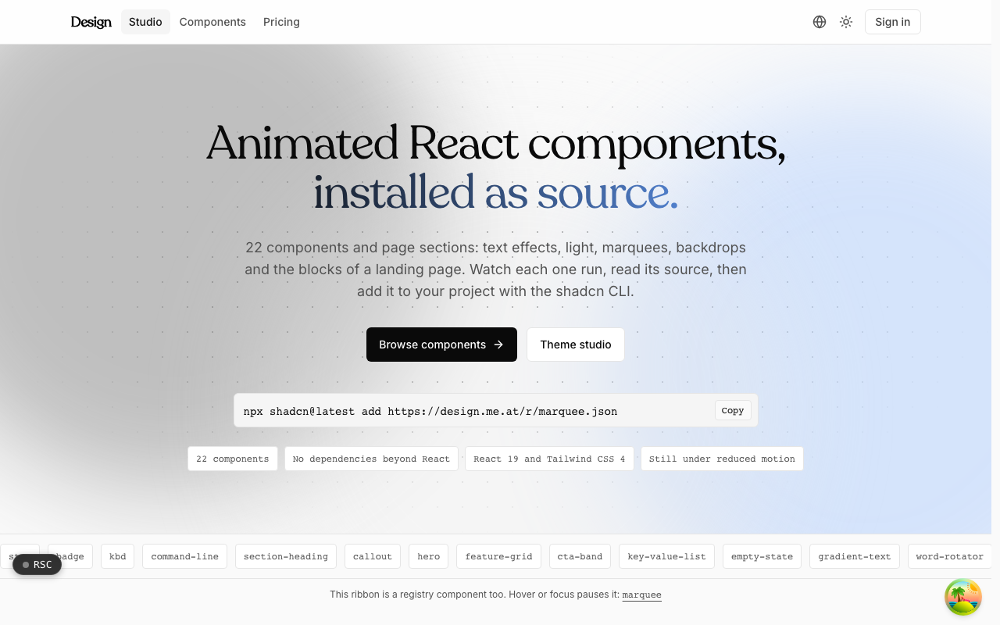
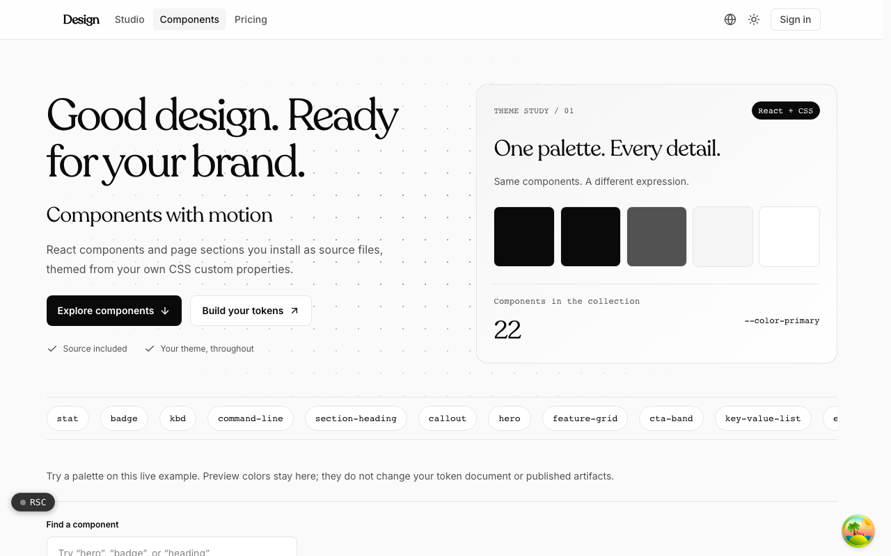
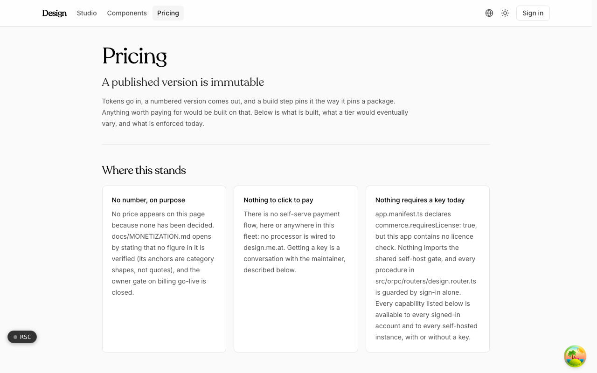

  <picture>
    <source media="(prefers-color-scheme: dark)" srcset=".github/assets/hero-dark.png">
    
  </picture>

# design.me.at

Animated React components, installed as source.

design.me.at combines an installable component catalog with a design-token studio. Preview animated components and page sections, read their source, and add them to your project with the shadcn CLI. Then author the color, type, space, and motion tokens behind your own brand once, publish an immutable version, and consume it as CSS custom properties, a Tailwind theme, DTCG JSON, or TypeScript.

> **Status:** in development. The catalog, registry, and studio are built; deployment, production storage, and pricing are not finalized.

## Features

- **Component registry**: 22 components and page sections (text effects, light, marquees, backdrops, and landing-page blocks), each with a live demo, props, theme properties, and source.
- **Install with the shadcn CLI**: every component is a registry item, so `npx shadcn add` copies the source into your project with no dependencies beyond React.
- **Themed from your tokens**: components read your CSS custom properties, and you can try a palette on a live example.
- **Token studio**: edit a DTCG token document, inspect resolved values and alias paths, and check declared contrast pairs.
- **Four output formats**: CSS, Tailwind, DTCG JSON, and TypeScript, emitted deterministically.
- **Immutable, versioned publishing**: published versions are content-addressed, with semver derived from the change (removed or retyped tokens imply a major).
- **Pin at build time**: consumers pin an exact version and content hash; there is no runtime token client.
- **Respects reduced motion**: animated components hold still under `prefers-reduced-motion`.

## Screenshots

<table>
  <tr>
    <td width="50%"><picture><source media="(prefers-color-scheme: dark)" srcset=".github/assets/components-dark.png"></picture> Components: the catalog, themed from your own CSS custom properties</td>
    <td width="50%"><picture><source media="(prefers-color-scheme: dark)" srcset=".github/assets/pricing-dark.png"></picture> Pricing: where the commercial side stands today</td>
  </tr>
</table>

## Built with

- Next.js 16 (App Router), React 19, TypeScript
- Tailwind CSS 4
- shadcn registry format
- DTCG design tokens
- oRPC + TanStack Query
- Drizzle ORM + Postgres
- Better Auth (shared `*.me.at` account)

## Part of the me.at family

design.me.at is one of the [`*.me.at`](https://me.at) apps by Trevor McDougald. They share one design system, account, and app shell. Development happens in a private monorepo; this repository is the project's public-facing home.

## License

See [LICENSE](LICENSE).
